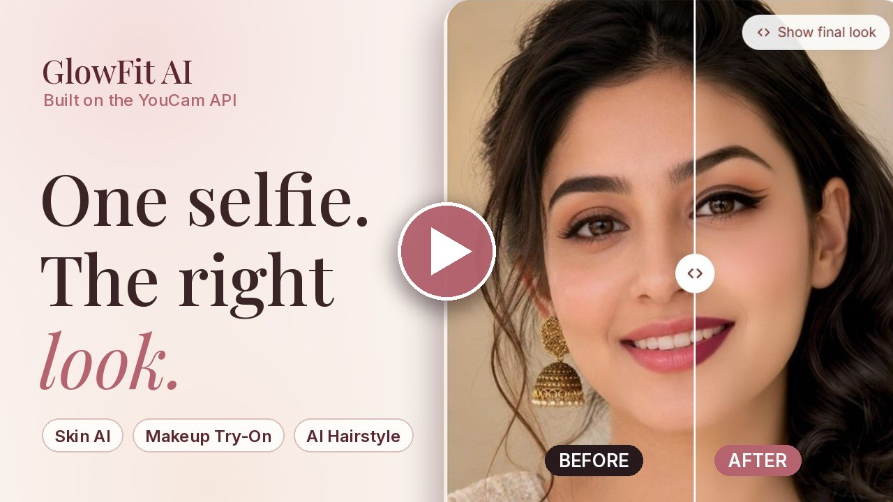
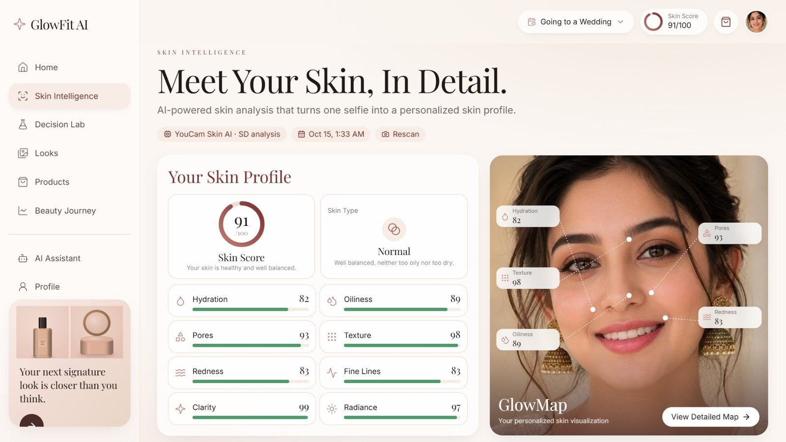
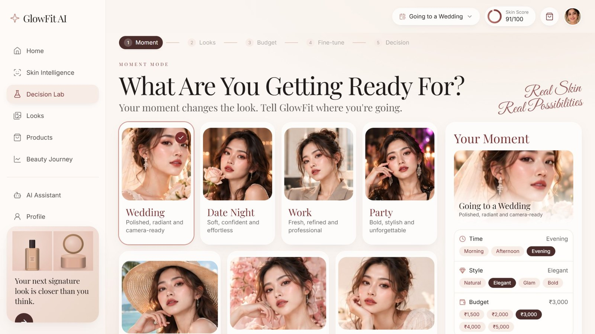
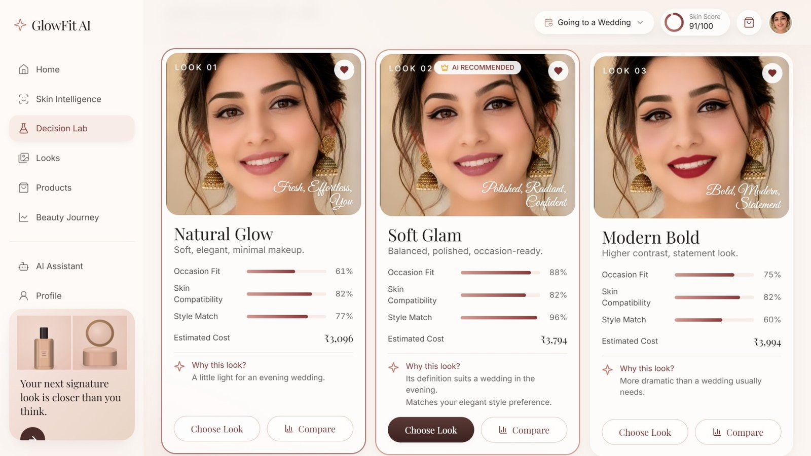
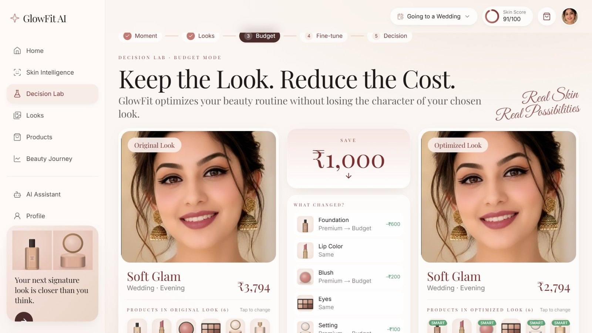
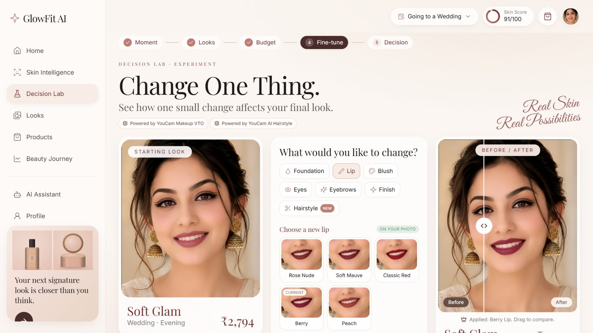
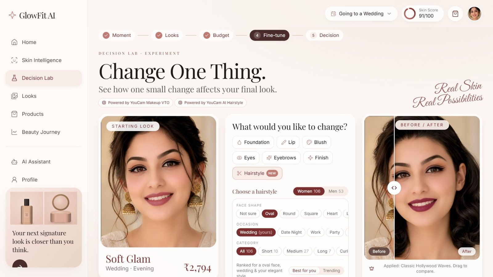
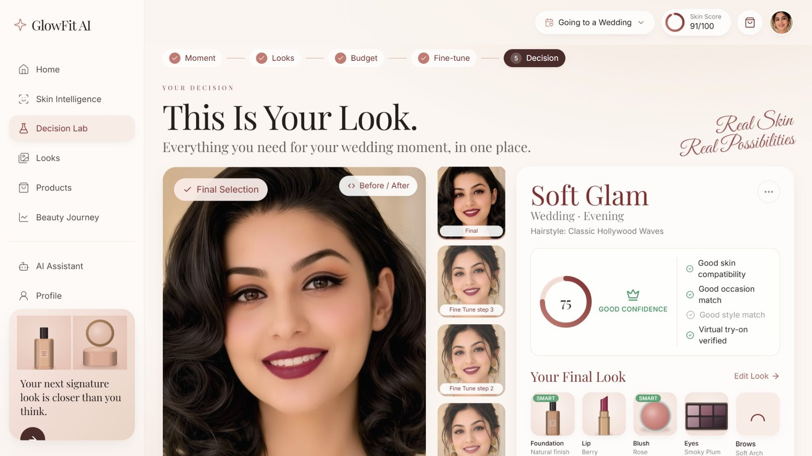

# GlowFit AI

> Don't just recommend. Let AI prove the choice.

GlowFit AI is a beauty decision engine built on the **YouCam API**. One selfie gives you a skin profile from **YouCam Skin Analysis**. You pick the moment you're getting ready for, and **YouCam Makeup VTO** and **YouCam AI Hairstyle** render looks on your own face. GlowFit then scores, compares, budgets and explains every choice, so you buy the right look with confidence.

**Tracks:** Skin AI + eCommerce VTO

[](https://youtu.be/EdBg7vJooeQ)

**[Watch the 2:44 demo on YouTube](https://youtu.be/EdBg7vJooeQ)** · **[Open the live app](https://glowfit-ai.vercel.app)**

## Try it

| | |
|---|---|
| Live demo | https://glowfit-ai.vercel.app |
| Demo video | https://youtu.be/EdBg7vJooeQ (2:44, recorded on the live app with real YouCam results) |
| No selfie? | On **Skin Scan**, click **Try with a sample face**. The whole app works and uses no API units. |

## What it does

| Screen | What you get | YouCam API |
|---|---|---|
| **Skin Scan** `/scan` | Camera or upload, drag-to-crop, live photo-quality checks, sample face | Skin Analysis |
| **Skin Intelligence** `/skin-intelligence` | Skin score, 8 metrics, skin type, GlowMap with **real per-metric AI masks**, top 3 priorities, care plan | Skin Analysis |
| **Decision Lab** `/decision-lab` | 5 steps: Moment, 3 Looks, Budget, Change One Thing, Decision | Makeup VTO, AI Hairstyle |
| **Looks** `/looks` | Saved looks, filtered by person, each with its own skin profile | none |
| **Products** `/products` | Shop the look, premium or budget picks per shade | none |
| **Skin Journey** `/journey` | Score over time, metric changes, insights, before/after, notes, routine | Skin Analysis |
| **Glow Assistant** `/assistant` | Chat grounded in your own data, with one-tap actions | none (rule engine) |
| **Profile** `/profile` | Your details, face shape, skin profile, history controls | none |

### The Decision Lab

The Decision Lab turns a skin profile into one confident purchase in five steps. Every screenshot below comes from the live app, using one real scan and real YouCam renders.

**Before the lab: Skin Intelligence.** One selfie goes to YouCam Skin Analysis and the AI Face Analyzer, side by side. The result is a skin score, a skin type, 8 metrics mapped on the face, face shape and ratios, and a care plan. Every score in the lab is computed from this profile.



#### 1. Moment: tell GlowFit where you're going

Pick the occasion (Wedding, Date Night, Work, Party and more), the time of day, the style and a budget. No API call is made here. These choices become part of every match score.



#### 2. Three Looks: see them on your own face

**Generate My 3 Looks** sends 3 recipes to **YouCam Makeup VTO**: Natural Glow, Soft Glam and Modern Bold. The selfie is uploaded once and its `file_id` is reused. Each look gets:
- a **match score** (occasion fit, skin compatibility, style match);
- an estimated cost;
- a plain-language **"Why this look?"**.

The best match is marked **AI Recommended**.



#### 3. Budget Mode: keep the look, reduce the cost

GlowFit keeps the shades that define the look and swaps the rest for lower-priced products. It shows the saving, what changed and what stayed. No new render is needed.



#### 4. Change One Thing: test a single change

Swap one element at a time: lip, blush, eyes, brows, finish, coverage or **hairstyle**.
- The impact on harmony, occasion fit, contrast and cost is scored for free **before** you render.
- **Preview** runs one real YouCam render on top of the current look.
- A before/after slider shows exactly what changed.
- Hairstyles come from **YouCam AI Hairstyle**, ranked for the occasion and style.

| Makeup change (Berry lip, Makeup VTO) | Hairstyle change (Classic Hollywood Waves, AI Hairstyle) |
|---|---|
|  |  |

#### 5. Decision: this is your look

The final screen brings together:
- the finished look, with every fine-tune step as a thumbnail and a before/after toggle;
- a **confidence score** with its checks (skin, occasion, style, virtual try-on verified);
- the exact products and the budget-optimized total.

From here you can view the products, save the look, change something, or share a **Look Card** (PNG).



| Step | YouCam calls | Units |
|---|---|---|
| Moment | none | 0 |
| Three Looks | 3 × Makeup VTO | 3 |
| Budget Mode | none | 0 |
| Change One Thing | 1 × Makeup VTO per preview, or 1 × AI Hairstyle | 1, or 2 for hair |
| Decision | none | 0 |

### What makes it different

- **Proof, not suggestions.** Every look has a score with plain-language reasons tied to your skin.
- **Preview before you pay.** Impact scores are free; renders only happen when you ask.
- **Budget-aware.** It keeps the look and changes the basket.
- **Grounded assistant.** Answers use your real scores, looks and budget. An optional free LLM only rewrites the wording, and the app rejects any rewrite that drops a number.
- **Made for brands.** The Decision Lab can be embedded on a product page or a store mirror with a retailer's catalog.

## YouCam APIs used

| API | Endpoints | Used for |
|---|---|---|
| Skin Analysis (SD/HD) | `POST /s2s/v2.0/file/skin-analysis`, `POST/GET /s2s/v2.0/task/skin-analysis` | 8 metrics, skin type, mask overlays (`enable_mask_overlay`) |
| AI Face Analyzer | `POST /s2s/v2.0/file`, `POST/GET /s2s/v2.0/task/face-attr-analysis` | Face shape, eye, lip and brow shape (5 features, 10 units), runs with each scan |
| Makeup VTO | `POST /s2s/v2.0/file/makeup-vto`, `POST/GET /s2s/v2.0/task/makeup-vto` | 3 looks + every "Change One Thing" preview |
| AI Hairstyle (hair transfer) | `/s2s/v2.1/task/template/hair-transfer`, `POST/GET /s2s/v2.1/task/hair-transfer` | Hairstyle templates and try-on on the finished look |
| Credit balance | `GET /s2s/v1.0/client/credit` | Key check and the public-demo reserve |

The API key stays on the server (Next.js route handlers in `src/app/api/youcam/`). The browser never sees it.

### How API units are saved

| Step | YouCam calls |
|---|---|
| Skin Scan | 1 skin analysis (HD only when the photo's short side is 1080px or more) + 1 face analysis (10 units) |
| Moment, Budget, Decision | none |
| Three Looks | 3 renders, only when you click **Generate** |
| Change One Thing | 1 render per **Preview**; impact scores are free |
| Hairstyle | 2 units per render; listing styles is free |

- The selfie is uploaded once and its `file_id` is reused for every render.
- Every render is cached in the browser (IndexedDB) by selfie and recipe, so the same look never costs twice.
- Demo mode and the sample face return bundled images and spend nothing.
- On-device MediaPipe (served from `public/mediapipe`) frames the face before upload and paints lip, eye and blush option previews on the user's own photo, with no API calls.

## Run locally

Requirements: Node.js 20 or newer.

```bash
npm install
cp .env.example .env.local     # Windows: copy .env.example .env.local
# put your key in .env.local: YOUCAM_API_KEY=...
npm run dev
```

Open http://localhost:3000. With no key, or with `GLOWFIT_DEMO_MODE=1`, the app uses sample results and spends no units.

### Environment variables

| Variable | Default | Purpose |
|---|---|---|
| `YOUCAM_API_KEY` | empty | Your YouCam API key (server only) |
| `YOUCAM_API_BASE` | `https://yce-api-01.makeupar.com` | YouCam API base URL |
| `GLOWFIT_DEMO_MODE` | `0` | `1` = always use sample results |
| `GLOWFIT_FACE_SHAPE` | `1` | `0` = skip the Face Analyzer call on each scan (saves 10 units) |
| `GLOWFIT_PUBLIC_DEMO` | `0` | `1` = turn on per-visitor limits for a public link |
| `GLOWFIT_MAX_SCANS` | `2` | Real skin scans per visitor (public demo) |
| `GLOWFIT_MAX_UNITS` | `12` | Real render units per visitor (public demo) |
| `GLOWFIT_MIN_CREDITS` | `100` | Units kept in reserve; below this, everyone gets sample results |
| `GLOWFIT_QUOTA_SECRET` | API key | Secret that signs the visitor quota cookie |
| `ASSISTANT_LLM_URL` / `_KEY` / `_MODEL` | empty | Optional OpenAI-compatible endpoint (Groq, Gemini, OpenRouter, Ollama) that polishes assistant wording |

When a public-demo limit is reached, the app keeps working with sample results and shows a short notice.

## Tech stack

Next.js 15 (App Router), React 19, TypeScript, Tailwind CSS, Zustand (browser storage, no login), IndexedDB render cache, lucide-react icons. No database: all user data stays in the browser.

## Project structure

```
src/
  app/
    page.tsx              Home
    scan/                 Skin Scan
    skin-intelligence/    Skin profile, GlowMap, care plan
    decision-lab/         5-step Decision Lab
    looks/ products/ journey/ assistant/ profile/
    api/youcam/           YouCam server routes (key stays on the server)
    api/assistant/        Optional LLM wording polish
  components/             UI by area: shell, scan, skin, lab, journey, home, ui
  data/products.json      Demo catalog (fictional brands, premium + budget per shade)
  lib/
    youcam.ts             YouCam client: upload, task, poll, normalize
    quota.ts              Public-demo limits (signed cookie + unit reserve)
    looks.ts              Look recipes and buildMakeupEffects() (YouCam payload)
    scoring.ts            Match scores from real skin metrics + moment
    skinCare.ts           Metric status, care plan, priorities
    journey.ts            Progress, insights, routine
    assistant.ts          Grounded Glow Assistant engine
    hairMatch.ts          Face-shape and occasion hairstyle matching
    lookCard.ts           Shareable Look Card (canvas PNG)
  store/glowfit.ts        Session state
```

## Notes

- All product brands and products are fictional demo data.
- GlowFit gives cosmetic guidance, not medical advice.

## License

MIT, see [LICENSE](LICENSE).
